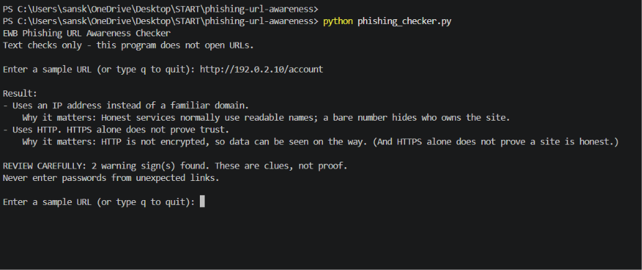
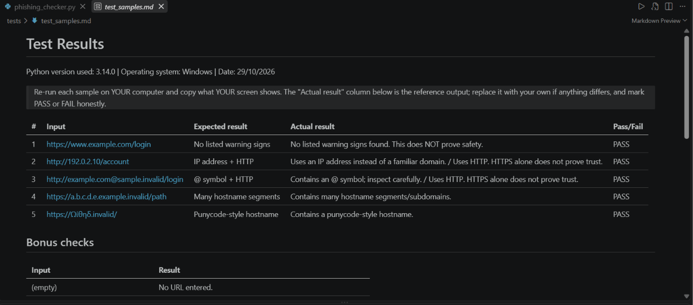
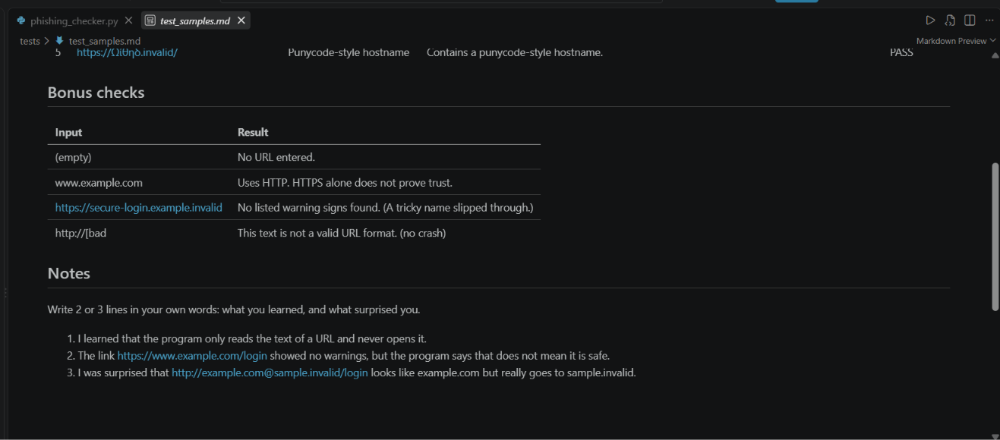

# Phishing URL Awareness Checker

## Overview
Phishing is a trick where criminals send fake links to steal passwords or other private information. This tool reads a URL as plain text and points out six warning signs, such as an @ symbol, an IP address or plain HTTP. It never opens the link and cannot prove a URL is safe.

## Features
- Detects an @ symbol in the URL
- Flags unusually long URLs (over 100 characters)
- Flags IP-address hostnames
- Flags many hostname segments (5 or more)
- Flags punycode-style hostnames (xn--)
- Flags the HTTP scheme
- Interactive loop with a quit command (q, quit, exit)
- "REVIEW CAREFULLY" summary with a warning count
- A one-line reason under every warning
- Safe handling of malformed input (no crashes)
- Batch mode and JSON output for lists of sample URLs
- Automated unit tests

## Requirements
Python 3.10 or later. No extra packages.

## How to Run
Windows: `python phishing_checker.py`
Mac/Linux: `python3 phishing_checker.py`

Batch mode (sample URLs only):
`python phishing_checker.py --file sample_urls.txt` (add `--json` for JSON)

## Example Output
```
Enter a sample URL (or type q to quit): http://192.0.2.10/account

Result:
- Uses an IP address instead of a familiar domain.
    Why it matters: Honest services normally use readable names; a bare number hides who owns the site.
- Uses HTTP. HTTPS alone does not prove trust.
    Why it matters: HTTP is not encrypted, so data can be seen on the way. (And HTTPS alone does not prove a site is honest.)

REVIEW CAREFULLY: 2 warning sign(s) found. These are clues, not proof.
Never enter passwords from unexpected links.
```

## Testing
Manual tests are in `tests/test_samples.md`. Automated tests:
`python -m unittest discover -s tests -v`

| # | Input | Expected | Actual | Result |
|---|-------|----------|--------|--------|
| 1 | https://www.example.com/login | No warning signs | No listed warning signs found | PASS |
| 2 | http://192.0.2.10/account | IP address + HTTP | IP address warning + HTTP warning | PASS |
| 3 | http://example.com@sample.invalid/login | @ symbol + HTTP | @ symbol warning + HTTP warning | PASS |
| 4 | https://a.b.c.d.e.example.invalid/path | Many hostname segments | Many hostname segments warning | PASS |
| 5 | https://xn--example.invalid/ | Punycode-style hostname | Punycode-style hostname warning | PASS |

## Screenshots




## Improvements
1. **Loop with quit** - The program used to stop after one URL. Now it keeps asking for URLs until I type q, so I can check many links in one run. I tested it by entering all five sample URLs one after another without restarting.
2. **Safe handling of bad input** - Typing something like http://[bad used to crash the program with a ValueError. Now it catches the error and prints a clear message instead. I tested it by typing http://[bad and checking that the program kept running.

## Limitations
This is an educational tool. It only reads URL text. It does not visit URLs,
scan for malware or prove that a URL is safe. No warning signs found does NOT
mean a URL is safe. The six checks are clues, not proof: honest links can
trigger them and dangerous links can trigger none (for example, a name with a
slightly wrong spelling).

## Privacy
Nothing you type is stored, logged or sent anywhere. The program makes no
network requests.

## Ethical Use
Use sample strings only. Do not collect credentials. Do not use this project
to deceive anyone or to test websites without permission.

## Roadmap (ideas, not built)
Suspicious words in the path, a simple score, more explanations - all still
text-only.

## Author
Sanskruti Aiwale, Cybersecurity 